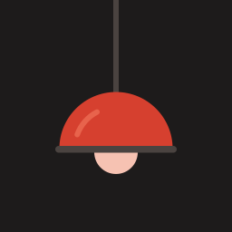

# Safelight

*Lightroom's way of working on the iPad, without Lightroom.*

Safelight is a native iPad app for developing RAW photos, built on
[RAWmakase](https://github.com/pch/rawmakase)'s engine: the same RAW
decoders, colour pipeline, catalog and edits as RAWmakase, under a touch
interface written in SwiftUI. It keeps RAWmakase's catalog format, so a
library edited on the iPad also opens in RAWmakase on a computer, and
renders the same there.

Safelight is an independent, personal project, MIT licensed like RAWmakase.
It isn't part of RAWmakase or affiliated with its maintainer; it builds on
their work and tries to stay a good neighbour to it.

> [!WARNING]
> **Early and in active development.** There is no App Store build: you
> build it yourself (below) and install it on your own iPad. Things move
> fast and some are rough; keep your originals elsewhere too until sync
> lands.

## What we want

Lightroom's cloud workflow is good: import on the iPad, edit anywhere, the
same photos on every device. It also means a subscription, Adobe's cloud as
the only copy of your library, and edits that only Adobe's apps read. The
goal is that workflow on your own terms:

- **Edit on the iPad as you would in Lightroom**: the same panels and
  sliders, masks with the Pencil, presets, AI Denoise and AI masks, export
  and share.
- **One library on iPad, iPhone and Mac**, synced through storage you
  choose (any S3-compatible bucket), with the originals and the edits yours.
- **Open formats**: the catalog is RAWmakase's SQLite catalog, Lightroom
  XMP presets and settings read as Lightroom means them, and originals are
  never changed.
- **Everything on the device**: rendering, AI Denoise and the AI masks run
  on the iPad; no photo leaves it unless you sync or share it.

## How

- **RAWmakase's crates, not a rewrite.** The app uses RAWmakase's own
  Rust crates (decoding, the renderer, the catalog, edit resolution, export,
  AI) from a fork, kept to the few changes iPadOS needs so RAWmakase's
  updates still merge: a submodule at `vendor/rawmakase` on the fork's
  [`ios/build-crates`](https://github.com/ljbergmann/rawmakase/tree/ios/build-crates)
  branch.
- **A small Rust core with a Swift API.** `core/` composes those crates
  into what the app calls, through [UniFFI](https://mozilla.github.io/uniffi-rs/):
  the library in the app's storage, the open edit with its History, the live
  preview, import and export. The rules of an edit stay in Rust, in one place.
- **A live preview on the GPU.** The engine renders straight into the
  view's Metal layer, at 60 fps while a slider moves on an M1 iPad Pro.
- **A native interface.** SwiftUI, modelled on Lightroom for iPad, with the
  Pencil's pressure for brushes.
- **Sync by changes, not by files.** Each device will write its own change
  records and upload originals by content hash; the SQLite file itself is
  never synced. Then smart previews, to edit without the original on the
  device.

Where this is going, and why, is the [vision](docs/VISION.md); what's left,
in order, is the [roadmap](docs/ROADMAP.md); how the port was first laid
out is [docs/PLAN.md](docs/PLAN.md).

## What works today

- **Library**: a catalog in the app's storage; import from a card or folder
  (its photos by day, those already in the catalog marked), from files in
  the Files app, and RAW originals from the Photos library;
  thumbnails; ratings, flags, colour labels,
  filters, Lightroom's sort orders, stacks, collections and the Quick
  Collection; Compare and Survey, to choose between photos;
  title, caption, creator, copyright and keywords, and the camera info;
  virtual copies; deleting (to Recently Deleted), renaming and moving photos
  and folders.
- **Develop**: every slider of RAWmakase's Develop; profiles and Profile
  Amount, and importing camera profiles, looks and `.cube` LUTs from Files; swiping to the next or previous photo; white balance presets and
  eyedropper (a circle to place, then ✓, as Lightroom samples); Auto; the point curve; the Color Mixer a band at a time, Point Color, and
  Color Grading's wheels; Crop, with Lightroom's guide overlays,
  Straighten, Rotate and Flip; Undo, Redo, Reset and a History you can step
  back through or clear; Snapshots; Before/After, side by side or split.
- **Masks and retouching**: brush (with the Pencil's pressure), linear and
  radial masks with their own sliders; Select Subject, Sky and Background;
  Heal and Clone.
- **AI Denoise**, on the device (about 38 s for a 45 MP photo on an M1 iPad
  Pro). The models are downloaded once, on request, and checked.
- **Presets**: RAWmakase's, your Lightroom XMP presets and your own (Create,
  Update, Rename, Delete), with Lightroom's Amount; Copy/Paste Settings,
  onto one photo or many.
- **Export** to JPEG, TIFF or PNG, and the share sheet.

What's missing compared with the desktop, and what comes next (sync…), is
in the
[roadmap](docs/ROADMAP.md). Measurements are in
[MEASUREMENTS.md](MEASUREMENTS.md).

## Build

You need a Mac with Xcode, [XcodeGen](https://github.com/yonaskolb/XcodeGen)
and rustup's stable toolchain with the iPad targets:

```sh
git clone --recurse-submodules https://github.com/ljbergmann/safelight
cd safelight
rustup target add --toolchain stable aarch64-apple-ios aarch64-apple-ios-sim
scripts/build-core.sh    # the Rust core and its Swift bindings
scripts/build-ort.sh     # Microsoft's ONNX Runtime for iOS, for the AI features
xcodegen generate
open Safelight.xcodeproj
```

Then run it on your iPad from Xcode, with your own team for signing. The
scripts use rustup's toolchain explicitly: a Homebrew `rustc` on `PATH` has
no iPad targets. Run `scripts/build-core.sh` again after changing `core/` or
the crates, and `scripts/acknowledgements.py` after changing the core's
dependencies or ONNX Runtime: it writes `app/Acknowledgements.txt`, the
licences the app shows under About Safelight › Acknowledgements.

For the App Store, `app/PrivacyInfo.xcprivacy` declares the "required reason"
APIs the app and its Rust core use (file timestamps, disk space, elapsed
time) and that it tracks no one and collects nothing; the app uses only the
system's standard encryption (`ITSAppUsesNonExemptEncryption` is NO).

From the command line (the iPad unlocked, Developer Mode on):

```sh
xcodebuild -project Safelight.xcodeproj -scheme Safelight -configuration Release \
  -destination 'id=<the iPad's UDID>' -derivedDataPath build/DerivedData \
  -allowProvisioningUpdates DEVELOPMENT_TEAM=<your team ID> build
```

## Layout

| Path | What |
| --- | --- |
| `app/Sources/` | The SwiftUI app; `app/Generated/` holds the Swift bindings the build writes |
| `core/` | The Rust core the app calls (`rawmakase-core`) |
| `vendor/rawmakase/` | RAWmakase, as a submodule on the fork's `ios/build-crates` branch |
| `scripts/` | Building the core and ONNX Runtime |
| `project.yml` | The Xcode project, for XcodeGen |
| `docs/` | The vision, the roadmap and the original plan; the logo in `docs/brand` (`scripts/render-icon.swift` draws the app icon from it) |

## Development

```sh
cd core && cargo test                 # the core's tests, on the Mac
cd vendor/rawmakase && make check     # after changing RAWmakase's crates
```

The app has launch options that do something and print what happened, for
checking it on a device without touching the screen (with `devicectl`, put
them after `--`):

| Option | What it does |
| --- | --- |
| `-import-documents` | Moves the photos in the app's Documents folder into the catalog |
| `-import-screen-test` | Lists the catalog's own photo folder as the import screen lists a card: every photo must show as already in the catalog |
| `-sort-test` | Prints the grid's first photos in each sort order |
| `-metadata-test` | Sets and reads back a title and a keyword on a test copy, with its camera info, then takes them off |
| `-virtual-copy-test` | Makes a virtual copy of the test copy, renames it and removes it |
| `-file-ops-test` | Moves the test copy into a new folder and back and renames it and back, with a virtual copy, then removes the copy |
| `-point-color` (with `-open -color-mix`) | Opens Point Color with its eyedropper's circle |
| `-point-color-ranges` (with `-open -color-mix`) | Samples a swatch in the middle of the photo and shows its ranges and Visualize Range |
| `-about` | Opens About Safelight |
| `-crop-guide <n>` (with `-open`) | Opens Crop with guide overlay n (0 Grid … 5 Golden Spiral) |
| `-wb-loupe` (with `-open`) | Opens the white balance eyedropper's sampling circle |
| `-import-profiles <folder>` (with `-open`) | Imports the profiles in that folder of the app's Documents as Import Profiles does, and lists the photo's profiles again |
| `-mask-color-test` (with `-open`) | Adds a mask over the whole photo and checks each of its Color sliders changes the live render, then goes back |
| `-show-mask` (with `-open`, after `-mask-test -keep`) | Opens the Masks pane on the first mask with its Color sliders |
| `-color-mix`, `-grading` (with `-open`) | Opens the Color Mixer, or the Color Grading pane |
| `-survey`, `-compare` | Opens Survey or Compare on four photos, passing over the test charts |
| `-stack-test` | Stacks three photos of the test copy's folder, expands and unstacks them (`-keep` leaves the stack) |
| `-photos-import-test` | Imports a copy of a catalog photo the way the Photos picker's originals come in; it must be found already there |
| `-open <file>` | Opens a photo of the catalog in the editor |
| `-sweep`, `-pan` (with `-open`, optionally `-full`) | Measures live rendering while a slider moves, or at 100% while panning |
| `-set-exposure <stops>`, `-save` | Edits and saves, to check edits survive a relaunch |
| `-reset`, `-clear-history` (with `-open`) | Resets the edit to the photo's starting settings, then clears History, before any `-set-exposure`: for putting a photo back |
| `-develop-test`, `-mask-test`, `-ai-test` | Exercise white balance, Auto, the curve, History, presets, snapshots and Before/After; masks and Heal; the AI models. The first two go back to the edit as opened (unless `-keep`, to look at what they did), but their steps stay in History; use them on a copy of a photo |
| `-loupe-test` (with `-open`) | Swipes to the next photo and back, waiting for each one's own edit |
| `-export <file>` | Exports a photo at full size, timed |
| `-benchmark`, `-allocprobe`, `-thumbnails`, `-rate <file> <stars>` | Rendering and memory measurements, thumbnails, ratings |

`-benchmark` renders each RAW in Documents on the GPU and the CPU and writes
`<name>.ipad.ppm` for comparing with the Mac's render (`cargo run --release
--example render` in `core/`, with `HOME` pointing at an empty folder so
neither side reads installed profiles).

## Contributing

Contributions are welcome. [CONTRIBUTING.md](CONTRIBUTING.md) says how to
build, where things live and what a change must keep; the
[roadmap](docs/ROADMAP.md) is a good place to pick something.

## License

MIT, as RAWmakase ([LICENSE](LICENSE)). RAWmakase is by its
[contributors](https://github.com/pch/rawmakase/graphs/contributors).
ONNX Runtime is Microsoft's (MIT); the AI models keep their own licences,
shown before each download.
